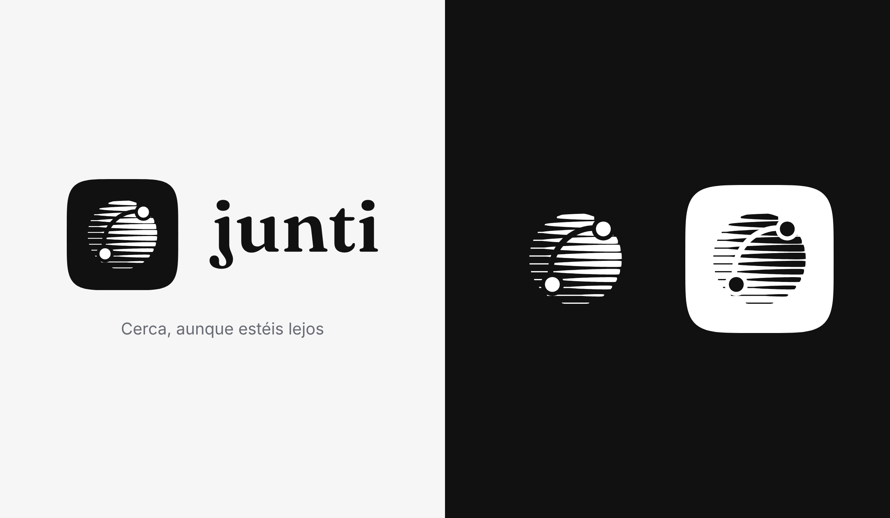
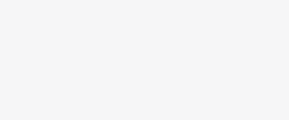

# Identidad de Junti (provisional)

**Idea.** Vuestro planeta, grabado con líneas horizontales como un linóleo: el grosor de cada línea le da volumen (la luz llega de arriba a la derecha y la otra mitad se va quedando en sombra, como cuando aquí es de día y allí de noche). Un surco recortado une a dos personas que están lejos. Va dentro de un *squircle* (superelipse), como el icono de una app. Solo blanco y negro.

**Archivos**

| Archivo | Uso |
|---|---|
| `icono-negro.svg` | El icono: j blanca sobre negro |
| `icono-blanco.svg` | Invertido, para fondos oscuros |
| `palabra.svg` | «junti» en Fraunces 600, pasado a trazos |
| `logo-horizontal.svg` | Icono y palabra juntos |

En la app: `mobile/src/components/logo.tsx` (`LogoMark`, `Wordmark`, `Logo`). Con `drawn` (0–1) se anima: aparece la forma, las líneas del planeta entran desde la luz una tras otra, aparece una persona, el surco viaja hasta la otra y entra la palabra. Las líneas se generan con un pequeño cálculo de luz sobre una esfera (12 franjas, radio 20 en una cuadrícula de 64).

**Lema.** *Cerca, aunque estéis lejos.*

**Colores** (`mobile/src/constants/brand.ts`). La marca es tinta `#111111` y blanco. El resto de colores es del planeta y de la interfaz, no del logo: océano `#58C3D6`, prado `#8CCB5B`, atardecer `#FF8A3D` (el hilo que une en el mapa) y letra a mano `#C2477A`.

**Tipografía.** Fraunces solo para la palabra «junti»; la del sistema para la interfaz; Caveat (a mano) para notas y subtítulos de la narradora.

**Movimiento.** Una sola curva suave, sin rebotes. Las animaciones cuentan algo: el planeta que se acerca, el hilo que se dibuja, el planeta que se enciende línea a línea.

Los iconos de la app (`mobile/public/icon-*.png`, `apple-touch-icon.png`, `logo.svg`, `assets/images/icon.png` y `favicon.png`) salen de `icono-negro.svg`.
